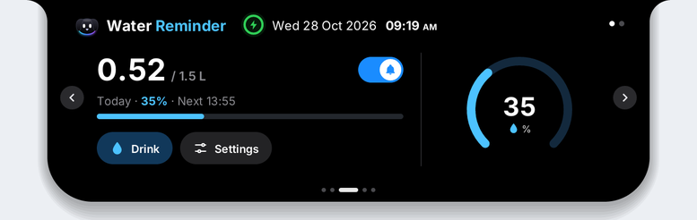
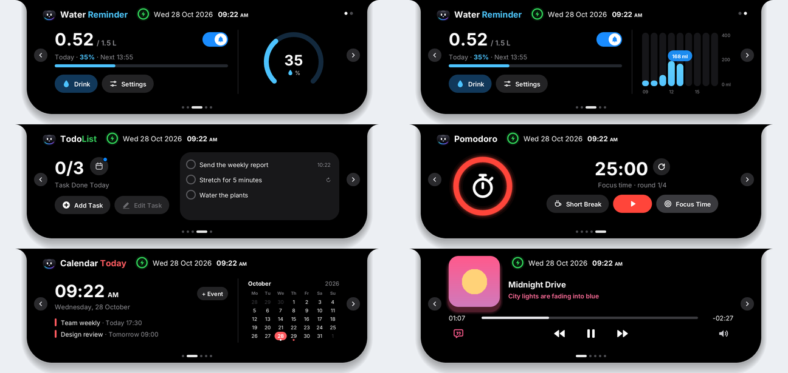
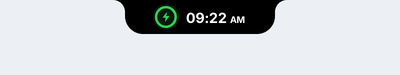
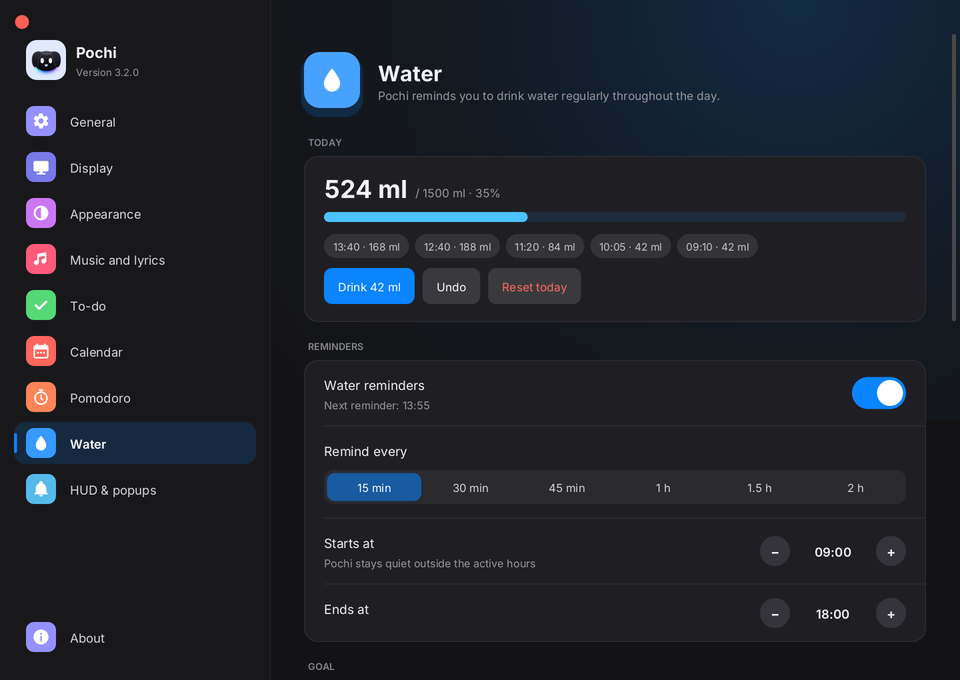

<p align="center">
  
</p>

<h1 align="center">Pochi</h1>

<p align="center">
  A lightweight, Dynamic Island–style notch for Windows, with <b>Pochi the dog</b> living inside.<br>
  Water reminders · To-do · Pomodoro · Calendar · Music controls with synced lyrics.
</p>

<p align="center">
  
</p>

## Why Pochi

- **Tiny and native.** Written in Rust and drawn directly with no browser engine underneath. About **1 MB** to download, around **15–25 MB of RAM**, and **0 % CPU** when idle.
- **Only draws when something moves.** While animating it syncs to your display's refresh rate; the rest of the time it sleeps until the clock ticks over or a reminder is due.
- **Event driven.** Windows tells Pochi when a song changes, the charger is plugged in or a full-screen app opens. Nothing is polled in the background.

## Features

<p align="center"></p>

| Page | What it does |
|---|---|
| **Water** | Daily goal, reminders inside your active hours that stay visible until you drink or snooze for 10 minutes, percent ring or hourly bars (click to switch), in-notch settings for bottle size, goal and hours |
| **To-do** | Add tasks right in the notch, optional reminder time, *Daily* tasks that reset every morning |
| **Pomodoro** | Focus / short / long breaks with a glowing ring and session stats |
| **Calendar** | Clock, month view and upcoming events with reminders |
| **Music** | Controls whatever is playing (Spotify, YouTube in a browser, Media Player…), album art, seek bar, volume and synced lyrics from [lrclib.net](https://lrclib.net) |

**Reminders** pop up as a compact capsule instead of opening the whole notch. The water drop shakes, and one click logs your drink:

<p align="center"></p>

**Pochi says hi.** Every now and then Pochi pops up on the notch and waves. Hover and its eyes follow your cursor, click to pet it, double-click to open the notch. After 11 pm it naps.

**Settings** window with a section for everything:

<p align="center"></p>

Other details:

- Auto-hide (shrinks to a thin line), minimal pill, or hide completely with **Ctrl + Alt + P**
- Hides automatically when a game, video or slideshow goes full screen
- Choose the display and size; per-monitor DPI aware
- Everything is also reachable from the tray icon's right-click menu

## Install

Download the latest **`Pochi-Setup-x.y.z.exe`** from [Releases](../../releases) and run it. The installer asks for administrator permission, installs Pochi under Program Files, and adds Start-menu and desktop shortcuts available to all users. Pochi's automatic startup setting remains per-user. Prefer no installer? Grab **`Pochi-Portable-x.y.z.exe`**: it's a single file.

Unsigned releases may trigger a Windows SmartScreen warning. Signing can be enabled for release builds as described under [Windows code signing](#windows-code-signing), but a trusted signature does not guarantee that SmartScreen will stop warning, especially for new or low-reputation releases.

Your data lives in `%APPDATA%\Pochi\pochi-data.json`.

## Build from source

### On Windows

```powershell
# Rust: https://rustup.rs
cargo build --release
# optional installer (NSIS: https://nsis.sourceforge.io)
makensis installer.nsi
```

### Cross-compile from Linux

```bash
rustup target add x86_64-pc-windows-gnu
sudo apt install gcc-mingw-w64-x86-64 nsis
cargo build --release --target x86_64-pc-windows-gnu
makensis -DEXE=target/x86_64-pc-windows-gnu/release/pochi.exe installer.nsi
```

### Previews without Windows

On Linux/macOS, `cargo run --release -- /tmp/pochi-preview` renders every notch page to PNG and prints per-frame timings. `POCHI_SETTINGS=/tmp/out cargo run --release` does the same for the Settings window, and `POCHI_ALERT=/tmp/out` renders the reminder animation frame by frame.

### Releases

Pushing a tag such as `v3.3.0` makes GitHub Actions build the exe and installer on Windows and attach them to a new Release (see `.github/workflows/build.yml`). Bump `version` in `Cargo.toml` first.

### Windows code signing

The Windows release workflow can sign both the installer and portable executable with an Authenticode certificate. To enable it, obtain a valid code-signing certificate issued to the publisher by a trusted certificate authority, export it as a password-protected PFX, then add these repository Actions secrets:

- `WINDOWS_PFX_BASE64`: the PFX file encoded as Base64.
- `WINDOWS_PFX_PASSWORD`: the PFX export password.

The workflow uses SHA-256 and a public RFC 3161 timestamp service, and removes its temporary PFX after signing. If either secret is missing, both executables remain unsigned; no self-signed certificate is generated. A certificate authority must verify the publisher identity before issuing a trusted certificate, and SmartScreen reputation is separate from signing, so warnings may continue until reputation is established.

## How it works

| File | Role |
|---|---|
| `src/win.rs` | Win32 shell: per-pixel-alpha layered window, render loop paced by `DwmFlush`, tray menu, hotkey, power and full-screen events |
| `src/ui.rs` | The notch: spring animations, pages, reminder capsule, Pochi's cameo, hit testing |
| `src/settings.rs` | Settings window |
| `src/media_win.rs` | Windows media session (WinRT), album art via WIC, lyrics via WinHTTP |
| `src/app.rs`, `src/data.rs` | Platform-independent logic: reminders, water, Pomodoro, to-dos, events, JSON storage |
| `src/gfx.rs` | Tiny 2D toolkit on [tiny-skia](https://github.com/RazrFalcon/tiny-skia) + [ab_glyph](https://github.com/alexheretic/ab-glyph) + [resvg](https://github.com/RazrFalcon/resvg) |

Text uses the fonts installed with Windows (Segoe UI). No fonts or third-party artwork are bundled.

## License

[MIT](LICENSE)
